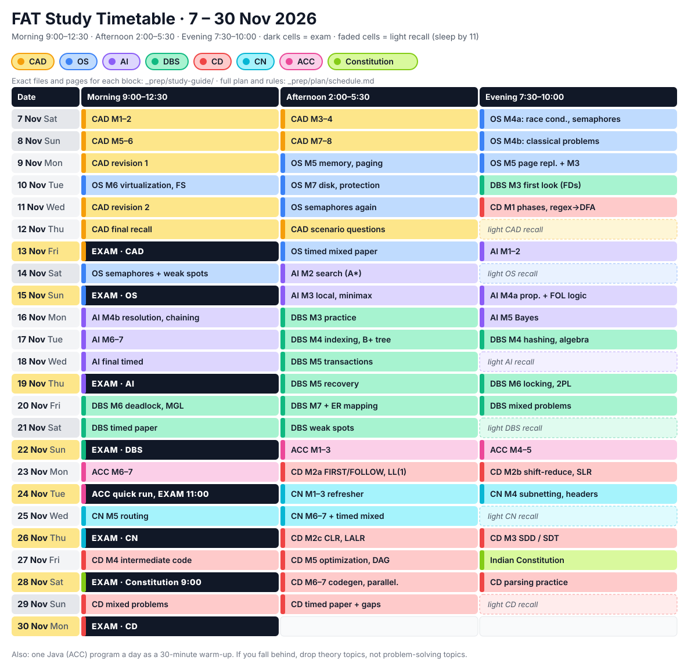

# VIT Semester 5: course material and FAT plan

## FAT study timetable (7 to 30 Nov 2026)

- Full plan, exam dates and rules for adjusting it: [`_prep/plan/schedule.md`](_prep/plan/schedule.md)
- Exact files and pages for each study block: [`_prep/study-guide/`](_prep/study-guide/)
- PYQ question indexes: [`_prep/pyq-index/`](_prep/pyq-index/)
- Planning layer overview: [`_prep/README.md`](_prep/README.md)

The rest of the repo is course material, one folder per subject (`AWS/` is Cloud Architecture Design).
