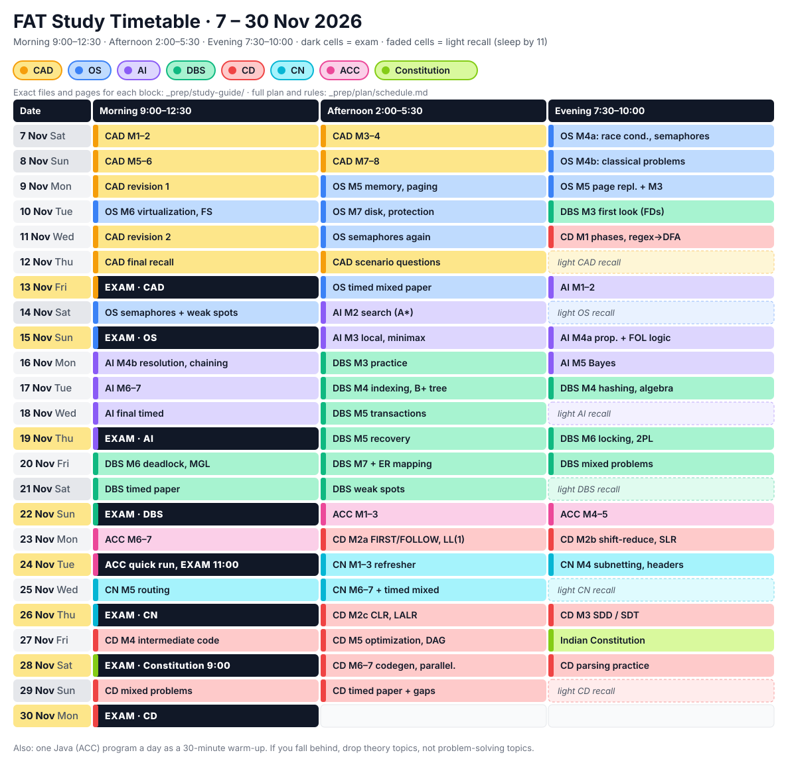

# FAT study schedule: 7 Nov to 30 Nov 2026

Last updated: Fri 6 Nov 2026, 23:10 IST. Owner: V C Pavitran. Edit this file when the plan changes (and note why at the bottom).

## Exam dates (FAT, all FN)
| Date | Course | Time |
|---|---|---|
| Fri 13 Nov | Cloud Architecture Design (CAD; folder `AWS/`) | 9:30-12:30 (report 8:45) |
| Sun 15 Nov | Operating Systems | 9:30-12:30 |
| Thu 19 Nov | Artificial Intelligence | 9:30-12:30 |
| Sun 22 Nov | Database Systems | 9:30-12:30 |
| Tue 24 Nov | Advanced Competitive Coding I (90 min, practical) | 11:00-12:30 (report 10:30) |
| Thu 26 Nov | Computer Networks | 9:30-12:30 |
| Sat 28 Nov | Indian Constitution (1 hr) | 9:00-10:00 (report 8:30) |
| Mon 30 Nov | Compiler Design | 9:30-12:30 |

## Daily rhythm (assumes about 8-9 effective hours a day; adjust if less)
Morning 9:00-12:30, Afternoon 2:00-5:30, Evening 7:30-10:00. On exam days the exam is the morning and the afternoon and evening go to the next subject. The evening before each exam is light (1-1.5 hours of formulas and recall), then sleep by 11. Each block: 10 min orient, about 90 min learn, 60+ min solve problems, 15 min closed-book recall.

## Schedule

_Colour image above (also as [timetable.png](timetable.png) for phones). Same plan as a text table below; coloured squares mark the subject._

Legend: 🟧 CAD 🟦 OS 🟪 AI 🟩 DBS 🟥 CD 🟨 CN 🟫 ACC ⬜ Constitution ⬛ exam  (_italic_ = light recall evening)

| Date | Morning 9:00–12:30 | Afternoon 2:00–5:30 | Evening 7:30–10:00 |
|---|---|---|---|
| 7 Nov Sat | 🟧 CAD M1–2 | 🟧 CAD M3–4 | 🟦 OS M4a: race cond., semaphores |
| 8 Nov Sun | 🟧 CAD M5–6 | 🟧 CAD M7–8 | 🟦 OS M4b: classical problems |
| 9 Nov Mon | 🟧 CAD revision 1 | 🟦 OS M5 memory, paging | 🟦 OS M5 page repl. + M3 |
| 10 Nov Tue | 🟦 OS M6 virtualization, FS | 🟦 OS M7 disk, protection | 🟩 DBS M3 first look (FDs) |
| 11 Nov Wed | 🟧 CAD revision 2 | 🟦 OS semaphores again | 🟥 CD M1 phases, regex→DFA |
| 12 Nov Thu | 🟧 CAD final recall | 🟧 CAD scenario questions | 🟧 _light CAD recall_ |
| **13 Nov Fri** | ⬛ **EXAM · CAD** | 🟦 OS timed mixed paper | 🟪 AI M1–2 |
| 14 Nov Sat | 🟦 OS semaphores + weak spots | 🟪 AI M2 search (A*) | 🟦 _light OS recall_ |
| **15 Nov Sun** | ⬛ **EXAM · OS** | 🟪 AI M3 local, minimax | 🟪 AI M4a prop. + FOL logic |
| 16 Nov Mon | 🟪 AI M4b resolution, chaining | 🟩 DBS M3 practice | 🟪 AI M5 Bayes |
| 17 Nov Tue | 🟪 AI M6–7 | 🟩 DBS M4 indexing, B+ tree | 🟩 DBS M4 hashing, algebra |
| 18 Nov Wed | 🟪 AI final timed | 🟩 DBS M5 transactions | 🟪 _light AI recall_ |
| **19 Nov Thu** | ⬛ **EXAM · AI** | 🟩 DBS M5 recovery | 🟩 DBS M6 locking, 2PL |
| 20 Nov Fri | 🟩 DBS M6 deadlock, MGL | 🟩 DBS M7 + ER mapping | 🟩 DBS mixed problems |
| 21 Nov Sat | 🟩 DBS timed paper | 🟩 DBS weak spots | 🟩 _light DBS recall_ |
| **22 Nov Sun** | ⬛ **EXAM · DBS** | 🟫 ACC M1–3 | 🟫 ACC M4–5 |
| 23 Nov Mon | 🟫 ACC M6–7 | 🟥 CD M2a FIRST/FOLLOW, LL(1) | 🟥 CD M2b shift-reduce, SLR |
| **24 Nov Tue** | ⬛ **ACC quick run, EXAM 11:00** | 🟨 CN M1–3 refresher | 🟨 CN M4 subnetting, headers |
| 25 Nov Wed | 🟨 CN M5 routing | 🟨 CN M6–7 + timed mixed | 🟨 _light CN recall_ |
| **26 Nov Thu** | ⬛ **EXAM · CN** | 🟥 CD M2c CLR, LALR | 🟥 CD M3 SDD / SDT |
| 27 Nov Fri | 🟥 CD M4 intermediate code | 🟥 CD M5 optimization, DAG | ⬜ Indian Constitution |
| **28 Nov Sat** | ⬛ **EXAM · Constitution 9:00** | 🟥 CD M6–7 codegen, parallel. | 🟥 CD parsing practice |
| 29 Nov Sun | 🟥 CD mixed problems | 🟥 CD timed paper + gaps | 🟥 _light CD recall_ |
| **30 Nov Mon** | ⬛ **EXAM · CD** |  |  |

Also: one ACC (Java) program a day as a 30-minute warm-up from 7 Nov.

## Block counts (full study blocks)
CAD 8, OS 9, AI 8, DBS 12, ACC 3 (+ daily warm-ups), CN 4, CD 11, Indian Constitution 1.

## Rules for adjusting
- If you fall behind, drop the Remember/Understand-level theory topics, not the problem-solving topics.
- Do not shift the whole schedule when one block is lost: cut the lowest-value topic of the next block instead.
- Per-subject block guides (exact files and pages) live in `_prep/study-guide/`. PYQ question indexes live in `_prep/pyq-index/`.

## Change log
- 6 Nov 23:10: first version. Built from the 7 syllabi, the FAT timetable, and self-ratings (see `context.md`). Block counts rebalanced after learning CN and OS numericals are strong and DBS, CD, OS semaphores are weak.
